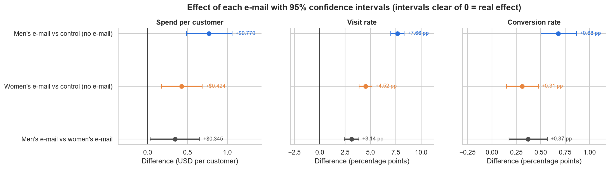

# Which e-mail should we send? An A/B test of a 64,000-customer campaign

An end-to-end A/B testing case study on a real retail e-mail experiment. It covers:
- checking that the data and the randomization can be trusted;
- measuring each campaign's effect with confidence intervals;
- testing whether targeting customer segments would pay off;
- translating the results into revenue and break-even figures for a marketing manager.

## Business question

A retailer has two e-mail campaigns, one featuring **men's** merchandise and one featuring **women's**. Should it:

1. send the **men's e-mail**,
2. send the **women's e-mail**, or
3. **target** each campaign at the customer segments most likely to respond?

## Dataset

The [**Hillstrom MineThatData E-Mail Challenge**](https://blog.minethatdata.com/2008/03/minethatdata-e-mail-analytics-and-data.html)
dataset (Kevin Hillstrom, 2008) contains real data from an unnamed US retailer.

- **64,000 customers** who bought in the past 12 months, **randomly assigned** to three equal groups: Men's
  e-mail, Women's e-mail, and No e-mail (control).
- **Outcomes**, tracked for **two weeks** after the send: website visit, purchase (conversion) and spend (USD).
- **Pre-campaign attributes:** recency, past-year spend, men's/women's purchase history, new vs existing customer,
  area, and purchase channel.

The column dictionary, SHA-256 checksum and source links are in [`data/README.md`](data/README.md). The raw file
`data/raw/hillstrom_email_experiment.csv` is never modified.

## Approach

| Step | Notebook | What it does |
|---|---|---|
| 1. Data check | [`01_data_check`](notebooks/01_data_check.ipynb) | Verifies the file checksum, data quality and the published figures. Checks that randomization worked: a **sample-ratio-mismatch** test and **covariate balance** (standardized mean differences). |
| 2. A/B test | [`02_ab_test`](notebooks/02_ab_test.ipynb) | Visit and conversion rates: **two-proportion z-tests** with Newcombe intervals. Spend, which is skewed: **bootstrap CIs** cross-checked with **Welch's t-test**. **Holm correction** for multiple comparisons. **CUPED-style regression adjustment**, minimum detectable effects, and **business impact with cost sensitivity and break-even**. |
| 3. Segments | [`03_segments`](notebooks/03_segments.ipynb) | Segment-level effects. **Interaction tests** to check whether effects truly differ. Evaluation of targeting policies, with **cross-fitting** to avoid the winner's curse. A per-segment recommendation, treated as exploratory. |

Every statistical choice is explained in plain English in the notebooks.

## Key result



*Each e-mail's lift on spend, visits and conversion, compared with the no-e-mail control (and with each other).
Intervals that don't cross zero are real effects. Every comparison stays significant after the Holm correction.*

Results per 10,000 e-mails sent, compared with sending no e-mail, over two weeks. Ranges are 95% confidence
intervals.

| | Men's e-mail | Women's e-mail |
|---|---|---|
| Extra buyers | **+68** (50 – 86) | +31 (15 – 47) |
| Extra revenue | **+\$7,698** (\$4,875 – \$10,589) | +\$4,244 (\$1,733 – \$6,856) |
| Break-even cost per e-mail (40% margin, assumed) | **\$0.31** | \$0.17 |

- **Both e-mails work, and the men's e-mail wins.** It more than doubles the purchase rate (1.25% vs 0.57%).
- **Targeting doesn't pay.** The women's e-mail works only on women's-product buyers, and even there it only *ties*
  with the men's e-mail. Matching e-mails to purchase history changes revenue by +\$7 per 1,000 customers
  (95% CI −\$177 to +\$185). Every data-mined targeting rule loses money when scored on held-out customers.

## Recommendation

**Send the men's e-mail to everyone.** Keep a 5–10% no-e-mail holdout in future sends. As a follow-up, test the men's
e-mail against matched and mixed-assortment creative.

**Limitations:**
- the data is from 2008 and from one US retailer;
- outcomes cover a two-week window only;
- e-mail costs and margins are not in the data, so profit figures use an assumed margin;
- segment results are exploratory.

**Reports:**
- [one-page recommendation memo (PDF)](reports/recommendation_memo.pdf), also available
  [in Markdown](reports/recommendation_memo.md);
- [stakeholder summary](reports/stakeholder_summary.md);
- [business impact and break-even tables](reports/business_impact.md).

## Part 2 (coming next): validating the results in GrowthBook

The next step is to re-run this experiment in [**GrowthBook**](https://www.growthbook.io/), an open-source
experimentation platform. The aim is to check that a production A/B-testing tool reaches the same conclusions as
the hand-built analysis, and to explain any differences. The plan:

- **Load the data** into a SQL data source that GrowthBook can query (e.g. a local PostgreSQL database), as an
  exposure table (customer, variant) and a metrics table. The dataset has no timestamps, so every customer gets
  the same synthetic exposure date.
- **Define the same metrics:** visit rate and conversion rate (binomial), and revenue per customer (mean).
- **Compare the results** against notebook 02:
  - lift and intervals;
  - significance;
  - the sample-ratio-mismatch check;
  - segment drill-downs (GrowthBook dimensions) against notebook 03.
- **Explain the differences.** These are the method choices most likely to make the numbers differ:
  - **Bayesian vs frequentist.** GrowthBook's default engine reports "chance to win" and credible intervals,
    while this project uses frequentist p-values and confidence intervals. GrowthBook also has a frequentist
    engine, so both can be compared.
  - **Relative vs absolute lift.** GrowthBook headlines percentage lift, while this project leads with absolute
    differences (percentage points and \$ per customer).
  - **Interval methods:** Newcombe and bootstrap intervals here, versus GrowthBook's own methods.
  - **Outlier handling:** any revenue capping or winsorization applied to the skewed spend metric.
  - **Multiple-comparison corrections and variance reduction (CUPED),** which depend on the settings used.

## How to reproduce

Requires **Python 3.12**.

```bash
git clone <this-repo-url>
cd ab-email-test

python -m venv .venv
# Windows:      .venv\Scripts\activate
# macOS/Linux:  source .venv/bin/activate
pip install -r requirements.txt
```

Run the notebooks **in order**. Notebook 01 creates `data/processed/hillstrom_clean.csv`, which notebooks 02 and 03
read.

```bash
jupyter nbconvert --to notebook --execute --inplace notebooks/01_data_check.ipynb
jupyter nbconvert --to notebook --execute --inplace notebooks/02_ab_test.ipynb
jupyter nbconvert --to notebook --execute --inplace notebooks/03_segments.ipynb
```

Alternatively, open them interactively with `jupyter lab`. All random steps use a fixed seed (`SEED = 42`), so the
numbers reproduce exactly. Notebook 03 takes a few minutes because of its bootstrap and cross-fitting loops.

## Project structure

```
ab-email-test/
├── data/
│   ├── README.md               # column dictionary, checksum, sources
│   ├── raw/                    # original CSV (read-only)
│   └── processed/              # cleaned data, generated by notebook 01 (git-ignored)
├── notebooks/
│   ├── 01_data_check.ipynb     # data quality + randomization checks
│   ├── 02_ab_test.ipynb        # effects, multiple comparisons, business impact
│   └── 03_segments.ipynb       # segment effects + targeting evaluation
├── src/                        # reusable helpers imported by the notebooks
│   ├── data.py                 # loading, checksum, cleaning, segment definitions
│   ├── stats.py                # proportion tests, bootstrap, Welch, Holm
│   ├── targeting.py            # policy value, bootstrap, cross-fitting
│   └── style.py                # shared chart colours and style
├── figures/                    # exported charts (PNG); main lift chart: 02_effects_forest.png
├── reports/                    # memo (MD + PDF), stakeholder summary, impact tables
├── requirements.txt
└── README.md
```
