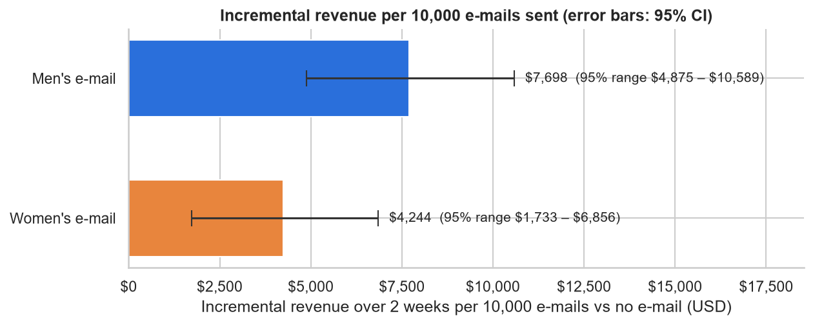
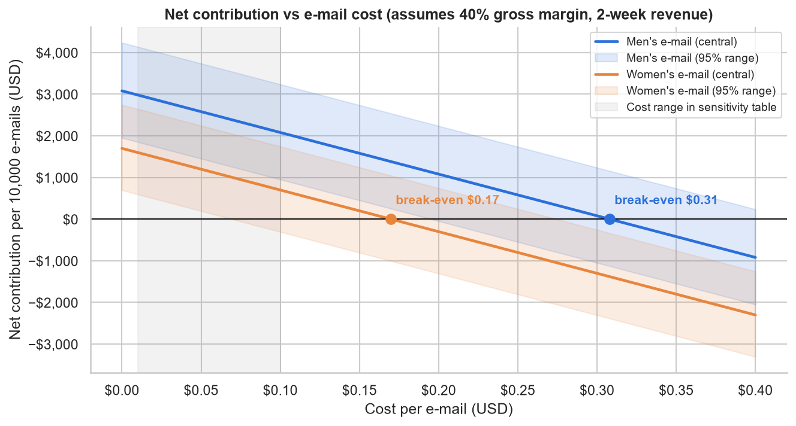

# Business impact of the e-mail campaigns

*Source: `notebooks/02_ab_test.ipynb`, section 8. Hillstrom e-mail experiment (2008, USD), revenue over the 2 weeks
after sending. Ranges are 95% confidence intervals.*

## Incremental revenue per 10,000 e-mails (vs no e-mail)

| Campaign | Extra buyers | Incremental revenue | 95% range |
|---|---|---|---|
| Men's e-mail | 68 (50 – 86) | \$7,698 | \$4,875 – \$10,589 |
| Women's e-mail | 31 (15 – 47) | \$4,244 | \$1,733 – \$6,856 |

## Net contribution per 10,000 e-mails by e-mail cost

Assumes a **40% gross margin** (no margin data in the dataset). Net contribution = margin × incremental
revenue − e-mail cost.

| Cost per e-mail | Cost per 10,000 e-mails | Men's e-mail | Women's e-mail |
|---|---|---|---|
| \$0.01 | \$100 | \$2,979 [\$1,850 – \$4,136] | \$1,598 [\$593 – \$2,642] |
| \$0.02 | \$200 | \$2,879 [\$1,750 – \$4,036] | \$1,498 [\$493 – \$2,542] |
| \$0.03 | \$300 | \$2,779 [\$1,650 – \$3,936] | \$1,398 [\$393 – \$2,442] |
| \$0.05 | \$500 | \$2,579 [\$1,450 – \$3,736] | \$1,198 [\$193 – \$2,242] |
| \$0.075 | \$750 | \$2,329 [\$1,200 – \$3,486] | \$948 [−\$57 – \$1,992] |
| \$0.10 | \$1,000 | \$2,079 [\$950 – \$3,236] | \$698 [−\$307 – \$1,742] |

## Break-even cost per e-mail

Central estimate (conservative estimate, using the low end of the 95% CI). Sending pays while an e-mail costs less
than this.

| Campaign | Revenue only | 50% margin | 40% margin | 30% margin |
|---|---|---|---|---|
| Men's e-mail | \$0.77 (\$0.49) | \$0.38 (\$0.24) | \$0.31 (\$0.19) | \$0.23 (\$0.15) |
| Women's e-mail | \$0.42 (\$0.17) | \$0.21 (\$0.09) | \$0.17 (\$0.07) | \$0.13 (\$0.05) |

