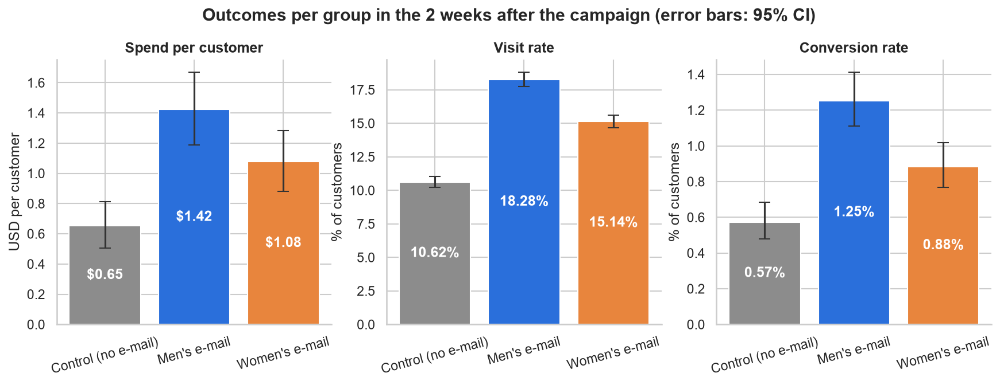
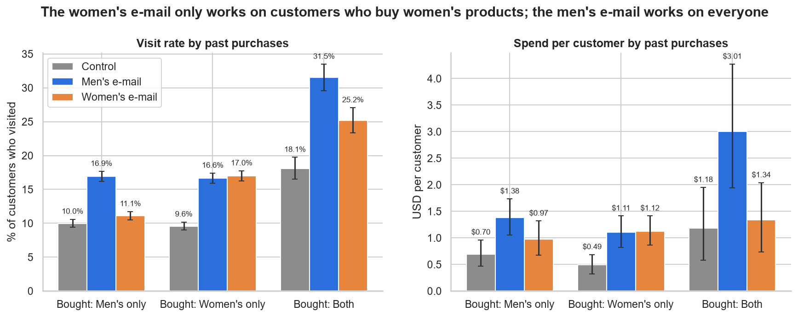

# E-mail Campaign Test: Results and Recommendation

**Audience:** Marketing & CRM leadership · **Data:** Hillstrom MineThatData e-mail experiment (64,000 customers, 2008, USD)
**Full analysis:** [`01_data_check`](../notebooks/01_data_check.ipynb) · [`02_ab_test`](../notebooks/02_ab_test.ipynb) · [`03_segments`](../notebooks/03_segments.ipynb)

---

## Recommendation

> **Send the men's e-mail to the whole customer list. Do not split the list by gender or purchase history.**

- **Both e-mails pay for themselves, and the men's e-mail is the clear winner.** It earned an estimated
  **+\$770 in extra revenue per 1,000 customers** in two weeks, compared with +\$424 for the women's e-mail.
- **Targeting adds nothing.** Sending women's-product buyers the women's e-mail earns the same as sending them the
  men's e-mail. No customer segment was found where switching e-mails pays off.
- **Estimated value at list scale:** roughly **+\$49,000 in revenue over two weeks** from mailing all 64,000
  customers the men's e-mail (95% range \$31,000–\$68,000). That is about **\$22,000 more** than the women's e-mail
  would bring.

---

## The question

The retailer had two campaign creatives, one featuring men's merchandise and one featuring women's. Should it send
the men's e-mail, the women's e-mail, or target each one to the customers most likely to respond?

## How it was tested

64,000 customers who had bought in the past year were **randomly split into three equal groups**: one got the
men's e-mail, one the women's e-mail, and one got nothing (the control group). Website visits, purchases and spend
were then tracked for two weeks. Because a random draw decided who got what, the groups were alike in every other
respect. Any difference in results can therefore be credited to the e-mail.

**We checked that the test can be trusted** before reading any results:
- the data matches the published original exactly;
- the three groups are the expected size;
- the groups have the same mix of customers (spend history, recency, location, channel, new vs existing).

All checks passed ([notebook 01](../notebooks/01_data_check.ipynb)).

---

## Result 1: Both e-mails work; the men's e-mail works best

| Per 1,000 customers e-mailed, vs. no e-mail | Men's e-mail | Women's e-mail |
|---|---|---|
| Extra website visits | **+77** (70 – 83) | +45 (39 – 52) |
| Extra buyers | **+6.8** (5.0 – 8.6) | +3.1 (1.5 – 4.7) |
| Extra revenue, 2 weeks | **+\$770** (\$487 – \$1,059) | +\$424 (\$173 – \$686) |

*Ranges are 95% confidence intervals: the plausible range for the true effect given the data.*

- **The men's e-mail more than doubled the share of customers who bought** (1.25% vs 0.57% with no e-mail).
- **It beat the women's e-mail on all three measures.** The lead in visits and buyers is very clear. The revenue
  lead (+\$0.35 per customer) is real but less precisely measured.
- **The men's e-mail brought in more buyers, but their orders were smaller** (median order \$67 vs \$88 without an
  e-mail). This suggests it tempts extra customers into smaller purchases.

## Result 2: Targeting by customer segment doesn't pay

We looked for customer groups that respond differently, across six attributes: past purchases, spend level, time
since last purchase, purchase channel, area, and new vs existing customers.

- **Only past purchases makes a difference.**
  - The women's e-mail barely registers with customers who only buy men's products (+1 point in visits).
  - The men's e-mail lifts every type of customer, and most of all those who buy both lines (+13 points in
    visits).
- **That difference doesn't create an opportunity.** Even among women's-product buyers, the women's e-mail only
  **ties** with the men's e-mail. Matching each customer to "their" e-mail changes revenue by +\$7 per 1,000
  customers, which is effectively zero (95% range −\$177 to +\$185).
- **Rules found by searching the data don't hold up.** Some segment rules looked up to +\$178 per 1,000 better at
  first. When tested on customers they weren't built from, every one of them did *worse* than simply sending the
  men's e-mail to everyone. The early gains were chance.

---

## Is it profitable?

The data contains revenue only, with no product margins or sending costs. Under an **assumed** 30–50% gross margin,
each men's e-mail generates **\$0.23–\$0.39 in gross profit** within two weeks. Sending an e-mail typically costs
a fraction of a cent, so the campaign is very likely profitable. This should be confirmed with actual margin and
cost figures.

**Break-even** (at a 40% margin): the men's e-mail pays as long as an e-mail costs less than **\$0.31** (\$0.19 if the
true effect is at the low end of its range). For the women's e-mail the figures are \$0.17 (\$0.07). For per-10,000
figures and costs from \$0.01 to \$0.10, see [`business_impact.md`](business_impact.md).

## Limitations

- **Old data (2008, USD, one unnamed US retailer).** Customer behaviour and e-mail channels have changed since then,
  so re-test before relying on the exact figures.
- **Two-week window.** Longer-term effects are not measured: later purchases, unsubscribes, or e-mail fatigue.
- **Revenue, not profit.** See the margin assumption above.
- **Segment results for spend are imprecise.** Only fairly large differences between segments could have been
  detected. A small benefit from targeting can't be ruled out, but there is no evidence for one.

## Suggested next steps

1. **Roll out the men's e-mail** as the default for this campaign type, and **keep a small no-e-mail group**
   (e.g. 5–10%) in every send so the true effect is always measured.
2. **Test a mixed-assortment e-mail against the men's e-mail.** The men's e-mail worked best on customers who buy
   from both lines, which suggests broad creative may beat gender-specific creative. About 20,000 customers per
   group are needed to reliably detect a revenue difference of the size seen here.
3. **Track results for 30–90 days, including unsubscribes and margin,** to confirm the campaign is profitable
   beyond the first two weeks.

---

Methods, in brief:
- **Rates:** two-proportion z-tests with Newcombe intervals.
- **Spend:** bootstrap intervals (10,000 resamples), cross-checked with Welch's t-test.
- **Multiple comparisons:** Holm correction.
- **Segment differences:** interaction regressions with robust standard errors.
- **Targeting rules:** scored on held-out customers (200 random half-splits).

Full details and plain-English explanations are in the notebooks.
